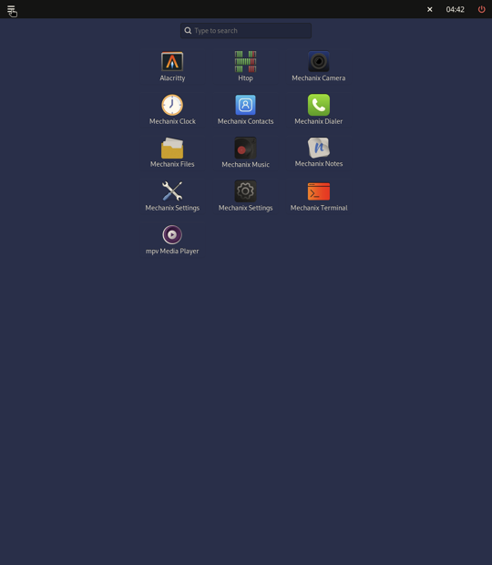
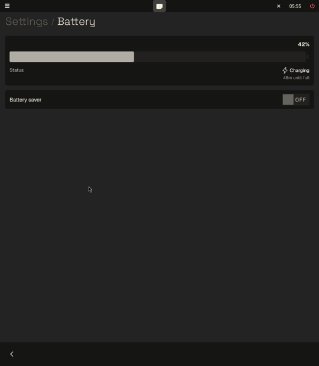
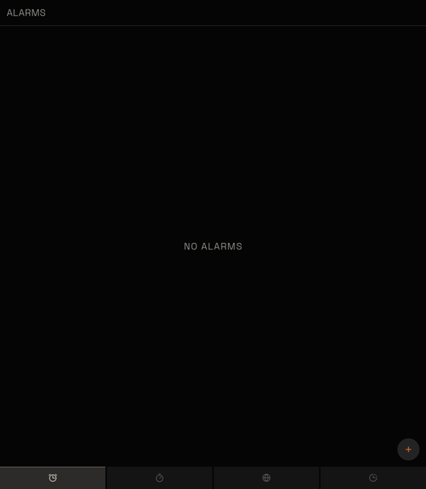

# mechumu

A virtual [Mecha Comet](https://mecha.so) you can run on your laptop. mechumu
boots the real Comet software (the Mecha Linux kernel, Mechanix OS and its apps)
in QEMU, at native speed on Apple Silicon and arm64 Linux. It simulates the
Comet's hardware buttons, battery, GPIO and CAN, and its 40-pin extension
connector: snap on the Keyboard, Gamepad or IO Breakout extension, or one you're
designing, without a device.

<p>
  
  
  
</p>

It has two modes:

| | Virtual Comet (`mechumu run`) | i.MX8MP EVK (`mechumu evk`) |
|---|---|---|
| For | App developers, learners, anyone without a device | Kernel and driver developers |
| Machine | QEMU `virt` with virtio devices | QEMU's chip-level NXP i.MX8MP EVK model |
| Screen | 1080×1240, the Comet panel's size | None: serial console only |
| Hardware | Simulated buttons, battery, GPIO, CAN, extension connector | The model's own i.MX UART, GPIO, FlexCAN, uSDHC |

## Quick start

You need QEMU 10.0 or later (older versions run `mechumu run` but lack the EVK model): `brew install qemu` on macOS,
`sudo dnf install qemu-system-aarch64 qemu-img` on Fedora, or
`sudo apt install qemu-system-arm qemu-utils` on Debian/Ubuntu.

There are no prebuilt images yet, so build one first (an arm64 host with Docker;
see [Building from source](#building-from-source)), then run it:

```sh
git clone https://github.com/redchief/mechumu.git && cd mechumu
./mechumu build
./mechumu run
```

The Comet's screen opens in a window and the serial console runs in your
terminal. For the whole device, run `./mechumu run --frame` instead: the screen
opens in your browser inside a drawing of the Comet, with working buttons and
an extension bay (see [Extensions](#extensions)). The UI is up about 20 seconds after launch on an M-series Mac. To quit,
press Ctrl-A then X in the terminal. Anything you change inside the Virtual
Comet is kept in `out/mechanix-os-virt.qcow2`; rebuild for a clean device.

## Using it

### Logging in

The session logs in on its own. For a shell, `mechumu run` hands your SSH public
key (`~/.ssh/id_ed25519.pub`, `id_ecdsa.pub` or `id_rsa.pub`) to the guest, so:

```sh
ssh -p 2222 root@localhost
```

Port 2222 listens on localhost only, as do the extension connector (3240) and
the device frame (8090). The `mecha` user's password is locked
unless you set one in `mechumu.env` before building (see
[Building from source](#building-from-source)).

### Simulated hardware

While the Virtual Comet is running, drive its hardware from another terminal:

```sh
./mechumu ctl battery 15 discharging   # level 0-100; charging, discharging or full
./mechumu ctl gpio 3 1                 # drive header line EXT_GPIO3 high
./mechumu ctl gpio                     # read all 16 lines
./mechumu ctl can 123#DEADBEEF         # inject a CAN frame on can0
./mechumu ctl button home              # press a button: power, home, volup, voldown
```

| Comet hardware | Inside the Virtual Comet | Read it with |
|---|---|---|
| Battery (BQ27441, 5.29 Wh) | A UPower and power-profiles service on D-Bus | Settings → Battery, the UPower D-Bus API |
| GPIO header | `gpio-sim` chip `comet-ext-gpio`, lines `EXT_GPIO0`–`EXT_GPIO15` | `gpioget`, libgpiod (user `mecha` is in group `gpio`) |
| CAN bus | Virtual CAN interface `can0` | `candump can0`, SocketCAN |
| Power, Home, Vol± buttons | Input devices `/dev/input/comet-*`, wired to `mechanix-system-service` | Its `org.mechanix.services.HwButton` D-Bus signals |

A daemon in the guest, `comet-simd`, applies these commands. It receives them
over a virtio serial port, which works on every host QEMU runs on.

### Extensions

The Comet's extensions snap onto a 40-pin connector below the screen. In the
Virtual Comet you attach them from the host, and they show up in the guest the
way the hardware does: on the connector's USB pins, through Linux's own drivers.

```sh
./mechumu ext attach keyboard          # or gamepad, io-breakout
./mechumu ext type "hello comet"       # drive the attached extension
./mechumu ext attach gamepad           # swapping is one step, like on the device
./mechumu ext press a
./mechumu ext detach
```

| Extension | In the Virtual Comet | Drive it with |
|---|---|---|
| Keyboard | A USB HID keyboard (ZMK's USB IDs), `Mecha Comet Keyboard` | `ext type <text>`, `ext press ctrl c` |
| Gamepad | A USB HID gamepad (the RP2040's USB IDs), `Mecha Comet Gamepad` | `ext press\|hold\|release a`, `ext dpad up`, `ext stick <x> <y>` |
| IO Breakout | A CP2102 USB serial port, `/dev/ttyUSB0`, whose other end is a terminal on your computer | `ext uart` prints its path; `screen <path> 115200` |

With `mechumu run --frame` the attached extension is drawn in the device's
extension bay: click its keys and buttons, or use your own keyboard, which types
through the keyboard extension (a Comet has no keyboard of its own) and plays the
gamepad (arrows, Z X A S).

Attaching or removing an extension also does what it does on a device:

- The connector's "extension detect" input (`KEY_F24`) changes, and
  `mechanix-system-service` reports it on D-Bus.
- Mecha's extension detector, `mechanix-extension-service`, probes the
  connector's I2C bus and announces the extension as `org.mechanix.Extensions`
  on the session bus.

#### Building your own extension

An extension model is a Python file. [`extensions/example.py`](extensions/example.py)
is a commented template: a macro pad (a USB HID keyboard with four keys) with a
TMP102 temperature sensor on the connector's I2C bus. Copy it, then:

```sh
./mechumu ext attach my_extension.py   # attach it again after each edit to reload it
./mechumu ext temp 31.5                # your model's own commands
```

In the guest, the stock `tmp102` driver reads the model:

```sh
echo tmp102 0x48 > /sys/class/i2c-dev/$(basename $(readlink /dev/i2c-comet-ext))/device/new_device
cat /sys/class/hwmon/hwmon*/temp1_input
```

A model describes its USB device (IDs, strings, interfaces and endpoints, or just
a HID report descriptor) and answers the connector's I2C transfers; the guest's
own drivers do the rest. [`lib/connector.py`](lib/connector.py) has the base
classes. Errors in a model land in `out/hub.log`.

### App-only mode

```sh
./mechumu run --app org.mechanix.clock
```

This boots straight into one app, full screen, without the status bar or
launcher. `--app` takes a desktop file ID from `/usr/share/applications`, or any
command. To try your own aarch64 build, copy it in with
`scp -P 2222 -r build/ root@localhost:/opt/myapp`, then boot with
`--app /opt/myapp/my_app`.

### i.MX8MP EVK mode

```sh
./mechumu evk
```

This boots the same kernel and root filesystem on QEMU's model of NXP's i.MX8MP
EVK board, the SoC family the Comet is built on. You get a serial console on the
board's debug UART. The simulators and the graphical session are turned off,
since the EVK model has a real FlexCAN and no display. Changes are thrown away
when it exits.

## Platform support

| Host | Virtual Comet | EVK |
|---|---|---|
| macOS, Apple Silicon | Native speed (HVF); llvmpipe software rendering | Native speed (HVF) |
| Linux arm64 | Native speed (KVM); host GPU through virgl | KVM |
| Linux or macOS x86-64 | Works, but slowly (full CPU emulation) | Works, but boots in minutes |
| Windows | Not supported (the launcher is a bash script; WSL2 may work) | |

On macOS the window sends mouse events, not touch; touch input works through
QEMU's GTK display on Linux.

## Building from source

Building needs an arm64 host (an Apple Silicon Mac or arm64 Linux) with Docker:

```sh
./mechumu build
```

The result lands in `out/`. The first build takes about an hour on an M-series
Mac (mostly the compositor's Rust build); later builds reuse the caches in the
`mechumu-cache` Docker volume and take minutes.
On Fedora 44 arm64 you can skip Docker and run `sudo build/build.sh` directly.

Optional settings go in `mechumu.env` (gitignored):

```sh
MECHA_USER_PASSWORD=...        # password for the mecha user (serial console and SSH)
MECHANIX_LOCKSCREEN_PIN=1234   # 4-digit lock screen PIN; unset means tap to unlock
```

## How it works

mechumu doesn't fork Mecha's code. [`build/build.sh`](build/build.sh) pins five
upstream repositories to exact commits and applies the small patches in
[`patches/`](patches):

| Upstream | What the patch adds | Status |
|---|---|---|
| [mecha-make](https://github.com/mecha-org/mecha-make) (the OS image build) | A `virt` mkosi profile: the Comet image for QEMU, plus the hardware simulators and app-only mode | To be proposed upstream |
| [mechanix-comp](https://github.com/mecha-org/mechanix-comp) (the compositor) | `MECHANIX_ALLOW_SOFTWARE_EGL`: allow software rendering, the only option without host GL | To be proposed upstream |
| [mecha-wayland](https://github.com/mecha-org/mecha-wayland) (the UI toolkit) | `MECHA_GLES_DEVICE`: render through a primary DRM node, which virtio-gpu without 3D needs | To be proposed upstream |
| [mechanix-keyboard](https://github.com/mecha-org/mechanix-keyboard) (the on-screen keyboard) | Build against the patched toolkit | Build-time only |
| [mechanix-gui](https://github.com/mecha-org/mechanix-gui) (the extension service) | `MECHANIX_EXTENSIONS_I2C_BUS`: which I2C bus the detector polls | To be proposed upstream |

The build compiles the patched compositor and keyboard and Mecha's extension
service, places them in the image's overlay with mechumu's own guest side
([`guest/`](guest)), and runs mkosi with the `virt` profile. That produces a
compressed qcow2 for `mechumu run` and extracts the kernel, initrd and EVK
device tree for `mechumu evk`. Every other package comes from Fedora 44 and
Mecha's Comet package repository, exactly as on a device.

The extension connector is a USB/IP server, `lib/hub.py`, which `mechumu run`
starts next to QEMU. On `ext attach`, `comet-simd` in the guest imports the
extension's USB device from it into the kernel's `vhci-hcd`, so `usbhid`,
`cp210x` and friends bind as on real hardware. The connector's I2C pins are an
always-attached `i2c-tiny-usb` adapter from the same server, linked as
`/dev/i2c-comet-ext`, whose transfers the attached model answers.

The `virt` profile differs from the device image in a few places:

- It uses the generic `virt` machine (virtio GPU, input, disk and network) instead of the i.MX8MP board.
- The session renders to QEMU's `Virtual-1` output.
- The Comet's USB gadget and backlight services are left out.

## Limitations

- **IMU:** the ICM-42605 isn't simulated; nothing in Mechanix reads it yet.
- **Connector pins:** USB and I2C carry real traffic; CAN and GPIO are the simulated `can0` and header lines. The UART, SPI, PWM, ADC and I2S pins aren't simulated yet.
- **Extension detection reply:** mechanix's I2C probe accepts any 8-byte reply framed `0xAA … 0xFF`, and Mecha hasn't published the format, so models echo the request.
- **Keyboard extension:** its `fn` and `123` layer keys and the top row of buttons aren't modelled; their firmware isn't published.
- **Device frame:** loads noVNC from jsDelivr, so it needs internet the first time. Through VNC the screen gets mouse events, not multi-touch.
- **Battery estimate:** the time-remaining figure assumes a 2 W draw, which is a guess.
- **EVK peripherals:** the model doesn't include the board's PMIC and I2C expanders, so their drivers log probe errors.

## Contributing

Issues and pull requests are welcome. Some guidelines:

- **Fixes to Mecha's code** should go upstream first. A patch in `patches/` is a stopgap until upstream ships the change, and each patch header says where it is meant to go.
- **Moving a pin:** update the commit in `build/build.sh`, then check that the patches still apply.
- **Testing:** before sending a change, run `tests/smoke.sh`. It boots the Virtual Comet headless and exercises every `mechumu ctl` command and every built-in extension end to end through the guest.

## License

mechumu is BSD-3-Clause licensed, like the Mecha projects it patches.
[LICENSE](LICENSE) covers this repository; images built from it contain
software under each package's own license. Mecha, Comet and Mechanix are names
of Mecha's products.
