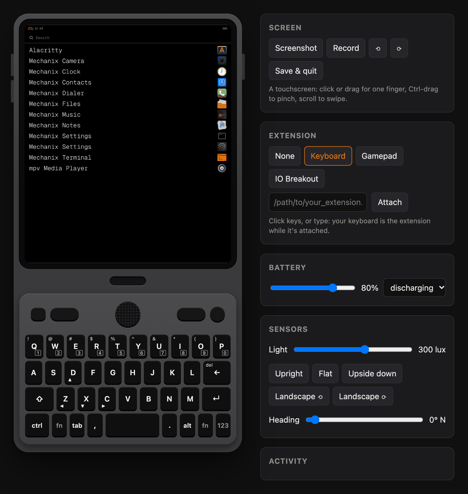
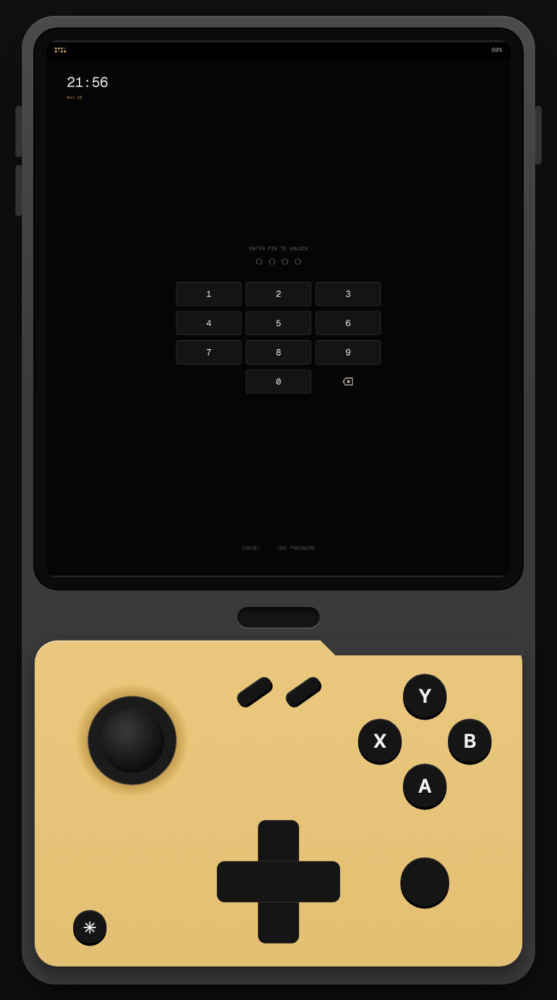
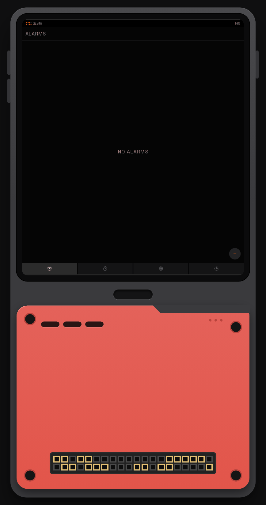

# mechumu

A virtual [Mecha Comet](https://mecha.so) you can run on your laptop. mechumu
boots the real Comet software (the Mecha Linux kernel, Mechanix OS and its apps)
in QEMU, at native speed on Apple Silicon and arm64 Linux. It simulates the
Comet's hardware buttons, battery and onboard sensors (IMU, light sensor,
magnetometer), and its 40-pin extension connector (USB, I2C, GPIO, ADC, UART and CAN): snap on the Keyboard, Gamepad or IO Breakout
extension, or one you're designing, without a device.

<p align="center">
  
</p>

<p align="center">
  
  
</p>

It has two modes:

| | Virtual Comet (`mechumu run`) | i.MX8MP EVK (`mechumu evk`) |
|---|---|---|
| For | App developers, learners, anyone without a device | Kernel and driver developers |
| Machine | QEMU `virt` with virtio devices | QEMU's chip-level NXP i.MX8MP EVK model |
| Screen | 1080×1240, the Comet panel's size | None: serial console only |
| Hardware | Simulated buttons, battery, sensors, CAN, extension connector | The model's own i.MX UART, GPIO, FlexCAN, uSDHC |

## Quick start

You need QEMU 10.0 or later (older versions run `mechumu run` but lack the EVK model): `brew install qemu` on macOS,
`sudo dnf install qemu-system-aarch64 qemu-img` on Fedora, or
`sudo apt install qemu-system-arm qemu-utils` on Debian/Ubuntu.

Download a prebuilt image from GitHub Releases (once a release is published), or build one from source (an arm64 host with Docker;
see [Building from source](#building-from-source)), then run it:

```sh
git clone https://github.com/redchief/mechumu.git && cd mechumu
./mechumu pull                         # or ./mechumu build
./mechumu run
```

The Comet's screen opens in a window and the serial console runs in your
terminal. For the whole device, run `./mechumu run --frame` instead: the screen
opens in a window of its own inside a drawing of the Comet, with working buttons
and an extension bay (see [Extensions](#extensions)), like Android's emulator.
There the screen is a touchscreen: click or drag for one finger, Ctrl-drag to
pinch, scroll to swipe. Its toolbar takes screenshots and screen recordings (to
`~/Downloads`), turns the device (the IMU turns with it), and saves and quits.
Closing the window saves and quits too (see Quick Boot below). The window is a
small Rust app in [`app/`](app), built the first time you use `--frame` if you
have Rust (`cargo`); without it, or with `--browser`, the frame opens in your
browser instead. The UI is up about 20 seconds after launch on an M-series Mac. To quit,
press Ctrl-A then X in the terminal. Anything you change inside the Virtual
Comet is kept in `out/mechanix-os-virt.qcow2`; rebuild for a clean device.

**Quick Boot.** Quit with `./mechumu stop` instead, from another terminal, and the
next `./mechumu run` resumes where you left off in a few seconds, apps and all,
like Android's emulator. `--cold` boots fresh instead, discarding the saved state. A few things don't carry
over: the attached extension is detached when you save, the sensors' simulated
readings and the connector's pin levels go back to their defaults, and a run with other options
(`--frame`, `--headless`, `--app`) or after updating mechumu or QEMU boots cold.
The saved state is used once, so after quitting any other way the next run boots
cold rather than bringing back a state the disk has moved on from.

## Using it

### Logging in

The session logs in on its own, into Mecha's shell
([mechanix-launcher](https://github.com/mecha-org/mechanix-launcher)): it starts
at the lock screen, as a Comet does. Press the power button if the screen has
gone dark, swipe up, and enter the PIN, **1234** unless you set your own in
`mechumu.env`. `./mechumu ctl unlock` unlocks it from the terminal. The screen
blanks after 30 seconds idle (10 when locked) and then only the power button
wakes it, as on the device; the Virtual Comet doesn't suspend.

For a shell, `mechumu run` hands your SSH public
key (`~/.ssh/id_ed25519.pub`, `id_ecdsa.pub` or `id_rsa.pub`) to the guest, so:

```sh
ssh -p 2222 root@localhost
```

Port 2222 listens on localhost only, as do the extension connector (3240) and
the device frame (8090). The `mecha` user's password is locked
unless you set one in `mechumu.env` before building (see
[Building from source](#building-from-source)).

### Simulated hardware

While the Virtual Comet is running, drive its hardware from another terminal:

```sh
./mechumu ctl battery 15 discharging   # level 0-100; charging, discharging or full
./mechumu ctl gpio 3 1                 # drive connector pin GPIO3 high
./mechumu ctl gpio                     # GPIO1-5: direction and level
./mechumu ctl adc 1 1.65               # put 1.65 V on connector pin ADC1
./mechumu ctl spi a5ff                 # send 2 bytes on connector SPI; prints what came back
./mechumu ctl pwm 3 1000 25            # set connector pin PWM3 to 1 kHz, 25% duty, as a guest app would
./mechumu ctl pwm                      # PWM3-4 as the Comet last set them
./mechumu ctl i2s play                 # play a tone on connector I2S, as a guest app would (or: record)
./mechumu ctl i2s                      # how much the Comet has played on I2S, and how loud
./mechumu ctl can 123#DEADBEEF         # inject a CAN frame on can0
./mechumu ctl button home              # press a button: power, home, volup, voldown
./mechumu ctl light 500                # ambient light in lux
./mechumu ctl tilt 90 0                # pitch and roll in degrees: 90 0 is upright, 0 0 flat
./mechumu ctl heading 90               # compass heading: facing east
./mechumu ctl brightness 40            # the panel backlight, in percent (or no number: read it)
./mechumu ctl tap 540 620              # touch the screen at x, y (pixels of the 1080x1240 panel)
./mechumu ctl swipe 540 1100 540 300   # drag a finger across it (optional: duration in ms)
./mechumu ctl screenshot shot.png      # save the screen
```

| Comet hardware | Inside the Virtual Comet | Read it with |
|---|---|---|
| Battery (BQ27441, 5.29 Wh) | A UPower and power-profiles service on D-Bus | Settings → Battery, the UPower D-Bus API |
| Connector GPIO1–5 | Lines 0–4 of `/dev/gpiochip-comet-ext`, with interrupts | `gpioget`, `gpiomon`, libgpiod (user `mecha` is in group `gpio`) |
| Connector ADC1–4 | An IIO ADC, 10 bits over 3.3 V | `/sys/bus/iio/devices/iio:device0/in_voltage<0-3>_raw` |
| Connector I2C | `/dev/i2c-comet-ext` | `i2c-dev`, kernel drivers via `new_device` |
| Connector PWM3, PWM4 | Two one-channel pwmchips, as on a Comet (`ls /sys/bus/usb/drivers/comet-pwm/*/pwm`: PWM3 first) | The PWM sysfs interface (`export`, `period`, `duty_cycle`, `enable`) |
| Connector I2S (SAI2) | A `Comet SAI2` sound card (48 kHz, 16-bit stereo, playback and capture) while the attached extension has I2S, as an extension's overlay would add one; PipeWire lists it below the Comet's own speaker and mic, which stay the defaults | Any ALSA or PipeWire app |
| Connector SPI | `/dev/spidev-comet-ext` (one chip select, 8-bit words) | Any spidev program (user `mecha` is in group `gpio`) |
| Connector UART1, UART2 | `/dev/comet-uart1`, `/dev/comet-uart2` (16550s) | Any serial program |
| CAN bus | Virtual CAN interface `can0` | `candump can0`, SocketCAN |
| IMU (ICM-42605) | IIO devices `icm42605-accel` and `icm42605-gyro`, via the stock driver | `in_accel_*_raw`, iio-sensor-proxy orientation (`monitor-sensor`) |
| Ambient light sensor (OPT3001) | IIO device `opt3001` | `in_illuminance_input`, iio-sensor-proxy light level |
| Magnetometer (LIS2MDL) | IIO device `lis2mdl` | `in_magn_*_raw` |
| Audio (MAX98090: speaker, headphones, mic) | An HDA sound card, PipeWire's default output (and input, on Linux hosts); plays on your computer's speakers (silent with `--headless`) | Any PipeWire, PulseAudio or ALSA app |
| Wi-Fi | A simulated radio, `wlan0`, for NetworkManager, with two networks in range: "Mecha Lab" (WPA2, password `mechumu-wifi`) and "Comet Guest" (open). They hand out addresses but don't lead to the internet; the Virtual Comet's own network stays on its Ethernet | The launcher's Wi-Fi settings, `nmcli`, NetworkManager's D-Bus API |
| Bluetooth | A controller for BlueZ (`hci0`, BlueZ's `btvirt` emulator), with two devices in range to discover: "Comet Buds" and "Mecha Speaker" | The launcher's Bluetooth controls, `bluetoothctl`, BlueZ's D-Bus API |
| Panel backlight | `/sys/class/backlight/32e60000.dsi.0`, the Comet's name for it, at 70% after boot; the device frame dims its screen to match | `mechanix-system-service` (`org.mechanix.services.Display`), the launcher's brightness slider, `mechumu ctl brightness` |
| Power, Home, Vol± buttons | Input devices `/dev/input/comet-*`, wired to `mechanix-system-service` | Its `org.mechanix.services.HwButton` D-Bus signals |

The connector's pins carry whatever the attached extension does (see
[Extensions](#extensions)); `ctl gpio` and `ctl adc` act as an extension would.
Inside the guest, `comet-simd` applies the other commands, which reach it over a
virtio serial port.

### Extensions

The Comet's extensions snap onto a 40-pin connector below the screen. In the
Virtual Comet you attach them from the host, and they show up in the guest the
way the hardware does: on the connector's USB pins, through Linux's own drivers.

```sh
./mechumu ext attach keyboard          # or gamepad, io-breakout
./mechumu ext type "hello comet"       # drive the attached extension
./mechumu ext attach gamepad           # swapping is one step, like on the device
./mechumu ext press a
./mechumu ext detach
```

| Extension | In the Virtual Comet | Drive it with |
|---|---|---|
| Keyboard | A USB HID keyboard (ZMK's USB IDs), `Mecha Comet Keyboard` | `ext type <text>`, `ext press ctrl c` |
| Gamepad | A USB HID gamepad (the RP2040's USB IDs), `Mecha Comet Gamepad` | `ext press\|hold\|release a`, `ext dpad up`, `ext stick <x> <y>` |
| IO Breakout | A CP2102 USB serial port, `/dev/ttyUSB0`, whose other end is a terminal on your computer | `ext uart` prints its path; `screen <path> 115200` |

With `mechumu run --frame` the attached extension is drawn in the device's
extension bay: click its keys and buttons, or use your own keyboard, which types
through the keyboard extension (a Comet has no keyboard of its own) and plays the
gamepad (arrows, Z X A S).

Attaching or removing an extension also does what it does on a device:

- The connector's "extension detect" input (`KEY_F24`) changes, and
  `mechanix-system-service` reports it on D-Bus.
- Mecha's extension service, `mechanix-extension-service`, recognises the
  extension's input device by its USB serial number and announces it as
  `org.mechanix.Extensions` on the session bus. (Its library can also probe for
  extensions over I2C, which the connector answers, but the service doesn't run
  that probe yet.)

#### Building your own extension

An extension model is a Python file. [`extensions/example.py`](extensions/example.py)
is a commented template: a macro pad (a USB HID keyboard with four keys) with a
TMP102 temperature sensor on the connector's I2C bus, an LED on GPIO1, a knob on
ADC1, a console on UART1, an LED bar on SPI (a 74HC595 shift register), a
backlight dimmed by PWM3, and a speaker amplifier and mic on I2S. Copy it, then:

```sh
./mechumu ext attach my_extension.py   # attach it again after each edit to reload it
./mechumu ext temp 31.5                # your model's own commands
```

In the guest, the stock `tmp102` driver reads the model:

```sh
echo tmp102 0x48 > /sys/class/i2c-dev/$(basename $(readlink /dev/i2c-comet-ext))/device/new_device
cat /sys/class/hwmon/hwmon*/temp1_input
```

A model describes its USB device (IDs, strings, interfaces and endpoints, or just
a HID report descriptor), answers the connector's I2C and SPI transfers (`i2c_write`,
`i2c_read`, `spi_transfer`, `spi_deselect`), and hears and drives its other pins (`on_gpio` / `set_gpio`, `on_pwm`, `adc`, `on_i2s` / `i2s_capture` with `i2s = True`,
`on_uart` / `uart_send`); the guest's own drivers do the rest. [`lib/connector.py`](lib/connector.py) has the base
classes. Errors in a model land in `out/hub.log`.

### Developer tools

Like `adb`, for the running Virtual Comet:

```sh
./mechumu shell                        # a root shell; or run one line: ./mechumu shell journalctl -b -p err
./mechumu logs                         # follow the journal; ./mechumu logs mechanix-keyboard follows one app's log
./mechumu push build/my_app            # copy a file or directory to /opt/ (or: push <path> <guest dir>)
./mechumu sync build/my_app --restart /opt/my_app/my_app  # watch & sync changes, restarting the app
./mechumu launch /opt/my_app/my_app    # run it in the session, as the mecha user; Ctrl-C stops it
./mechumu forward 8080 8080            # forward localhost:8080 into the guest over SSH
./mechumu sdk cargo build --release    # build an aarch64 Comet app in a Fedora 44 arm64 container
./mechumu kmod                         # rebuild kmod/comet-board and reload it in the running VM
```

For kernel and OS work on the `virt` machine, pass `--kernel <path>` (and optionally
`--initrd <path>` and `--cmdline <args>`) to `mechumu run` to boot a custom kernel
against the guest rootfs without rebuilding the image.

`launch` starts the program with the session's environment (its Wayland display
and the rendering settings the Virtual Comet needs), so it appears on the screen
like an app opened from the launcher.

### Devices

`--device <name>` before any command picks a separate Virtual Comet with its own
disk and saved state, like Android's virtual devices: one for trying things, say,
and one kept clean. A new device starts as a copy of the default one (instant on
an APFS Mac: a clone) on its first `run`.

```sh
./mechumu --device scratch run          # created on first run
./mechumu --device scratch ctl battery 5
./mechumu devices                       # list them; devices rm scratch deletes one
```

Each device gets its own localhost ports (SSH, USB/IP, and frame) so multiple Virtual Comets can run side by side.

### App-only mode

```sh
./mechumu run --app org.mechanix.clock
```


This boots straight into one app, full screen, without the status bar or
launcher. `--app` takes a desktop file ID from `/usr/share/applications`, or any
command. To try your own aarch64 build, copy it in with
`./mechumu push build/myapp` (to `/opt/myapp`), then boot with
`--app /opt/myapp/my_app`.

### i.MX8MP EVK mode

```sh
./mechumu evk
```

This boots the same kernel and root filesystem on QEMU's model of NXP's i.MX8MP
EVK board, the SoC family the Comet is built on. You get a serial console on the
board's debug UART. The simulators and the graphical session are turned off,
since the EVK model has a real FlexCAN and no display. Changes are thrown away
when it exits.

## Platform support

| Host | Virtual Comet | EVK |
|---|---|---|
| macOS, Apple Silicon | Native speed (HVF); llvmpipe software rendering, or the GPU with a virgl-capable QEMU in `MECHUMU_QEMU` ([details](docs/macos-gpu.md)) | Native speed (HVF) |
| Linux arm64 | Native speed (KVM); host GPU through virgl | KVM |
| Linux or macOS x86-64 | Works, but slowly (full CPU emulation) | Works, but boots in minutes |
| Windows | Not supported (the launcher is a bash script; WSL2 may work) | |

On macOS QEMU's window sends mouse events, not touch. For touch, use the device
frame (`--frame`) or `mechumu ctl tap` / `swipe`; on Linux, QEMU's GTK window
passes touchscreen input through too.

## Building from source

Building needs an arm64 host (an Apple Silicon Mac or arm64 Linux) with Docker:

```sh
./mechumu build
```

The result lands in `out/`. The first build takes about an hour on an M-series
Mac (mostly the compositor's Rust build); later builds reuse the caches in the
`mechumu-cache` Docker volume and take minutes.
On Fedora 44 arm64 you can skip Docker and run `sudo build/build.sh` directly.

Optional settings go in `mechumu.env` (gitignored):

```sh
MECHA_USER_PASSWORD=...        # password for the mecha user (serial console and SSH)
MECHANIX_LOCKSCREEN_PIN=4321   # 4-digit lock screen PIN; unset means 1234
```

## How it works

mechumu doesn't fork Mecha's code. [`build/build.sh`](build/build.sh) pins five
upstream repositories to exact commits and applies the small patches in
[`patches/`](patches):

| Upstream | What the patch adds | Status |
|---|---|---|
| [mecha-make](https://github.com/mecha-org/mecha-make) (the OS image build) | A `virt` mkosi profile: the Comet image for QEMU, plus the hardware simulators, app-only mode and starting the launcher | Proposed in [mecha-make#145](https://github.com/mecha-org/mecha-make/issues/145) |
| [mechanix-gui](https://github.com/mecha-org/mechanix-gui) (the extension service) | `MECHANIX_EXTENSIONS_I2C_BUS`: which I2C bus the detector polls | In review: [mechanix-gui#665](https://github.com/mecha-org/mechanix-gui/pull/665) |

The compositor ([mechanix-comp](https://github.com/mecha-org/mechanix-comp)), the shell
([mechanix-launcher](https://github.com/mecha-org/mechanix-launcher)) and the on-screen
keyboard ([mechanix-keyboard](https://github.com/mecha-org/mechanix-keyboard), for app-only mode) build unpatched:
their emulator opt-ins, `MECHANIX_ALLOW_SOFTWARE_EGL` ([mechanix-comp#27](https://github.com/mecha-org/mechanix-comp/pull/27))
and `MECHA_GLES_DEVICE` in the UI toolkit ([mecha-wayland#78](https://github.com/mecha-org/mecha-wayland/pull/78)),
are upstream. The launcher's and keyboard's lockfiles are moved to the mecha-wayland `dev` commit that has the latter.

The build compiles the compositor, the launcher, the keyboard and Mecha's
extension service, places them in the image's overlay with mechumu's own guest side
([`guest/`](guest)), and runs mkosi with the `virt` profile. That produces a
compressed qcow2 for `mechumu run` and extracts the kernel, initrd and EVK
device tree for `mechumu evk`. Every other package comes from Fedora 44 and
Mecha's Comet package repository, exactly as on a device.

The extension connector is a USB/IP server, `lib/hub.py`, which `mechumu run`
starts next to QEMU. On `ext attach`, `comet-simd` in the guest imports the
extension's USB device from it into the kernel's `vhci-hcd`, so `usbhid`,
`cp210x` and friends bind as on real hardware. The connector's I2C, SPI, GPIO and ADC
pins are an always-attached Diolan DLN-2 adapter from the same server, which
mainline drivers turn into an I2C bus, an SPI controller, a gpiochip and an IIO
ADC; the hub passes each transfer to the attached model. Linux only creates SPI
devices from firmware, so the comet-board module (below) adds one for spidev. No
DLN-2 has PWM, so the adapter has a second interface of mechumu's own for PWM3
and PWM4, and comet-board's USB driver turns it into two pwmchips. While the
attached extension has I2S, the server also offers a USB audio device for the
SAI2 pins, which the guest's `snd-usb-audio` makes a sound card; the server
completes its isochronous transfers in real time, so audio plays at its true rate. UART1 and UART2 are QEMU PCI serial ports
whose other ends the hub holds.

The Comet's onboard sensors sit on its internal I2C3 bus. The same server
provides a second adapter for that bus, with register-level models of the three
chips ([`lib/sensors.py`](lib/sensors.py)). A small kernel module,
[`kmod/comet-board`](kmod/comet-board), registers the devices on it as the
Comet's devicetree does, and their mainline drivers bind. The Virtual Comet boots
with a devicetree rather than ACPI, as a Comet does, because the IMU's driver
takes its configuration from it.

The `virt` profile differs from the device image in a few places:

- It uses the generic `virt` machine (virtio GPU, input, sound, disk and network) instead of the i.MX8MP board.
- The session renders to QEMU's `Virtual-1` output.
- The Comet's USB gadget and backlight services are left out.

## Limitations

- **IMU buffering:** the IMU's data-ready interrupt never fires, so raw reads and polling work but FIFO-buffered capture doesn't; iio-sensor-proxy is set to poll it.
- **Sensor axes:** chosen so iio-sensor-proxy reports the right orientation; the Comet's actual mounting (its mount matrix) isn't published.
- **Connector pins:** USB, I2C, SPI, GPIO, ADC, PWM, I2S and the UARTs reach the model; CAN is a guest-side `can0`. SPI is one spidev device, so a kernel SPI driver can't bind to an extension's chip the way a devicetree overlay would make it on a Comet; SPI modes and word sizes other than 8 bits aren't modelled. PWM3 and PWM4 carry settings (period, duty cycle, polarity, enable), not waveforms. I2S runs at one format, 48 kHz 16-bit stereo, and the sound card is a USB audio device rather than an SAI-and-codec card, so ALSA names it `Comet SAI2` instead of after the extension's codec.
- **Extension detection reply:** mechanix's I2C probe accepts any 8-byte reply framed `0xAA … 0xFF`, and Mecha hasn't published the format, so models echo the request.
- **Keyboard extension:** its `fn` and `123` layer keys and the top row of buttons aren't modelled; their firmware isn't published.
- **Home button:** pressed, it reaches the guest as `KEY_HOME`, but Mecha's launcher doesn't act on it yet (it takes only the power and volume keys); swipe up from the bottom edge for the app drawer.
- **Device frame:** a mouse makes at most two fingers (Ctrl-drag pinches about the screen's centre); a touchscreen makes up to seven.
- **Audio:** one stereo output and input, not the MAX98090's separate speaker, headphone and mic routes; ALSA names the card `HDA Intel`, not `max98090-audio` (HDA rather than virtio sound because QEMU can't snapshot virtio sound, which Quick Boot needs). On macOS and with `--headless`, QEMU can only play sound, so there the card has no mic. The Comet's vibration motor isn't modelled: Mecha's kernel doesn't build its driver, and nothing in Mechanix calls its haptics service.
- **Bluetooth:** the devices in range can be discovered, not paired: they're emulated controllers under the same bluetoothd, so the device's side of pairing waits on the same agent as the Comet's, where a real device would answer it itself. `btvirt` is built from Fedora's BlueZ source package, since Fedora doesn't ship it.
- **Wi-Fi:** the two networks are always in range at full signal; there's no roaming, and joining one gives no internet (the Ethernet keeps that).
- **Battery estimate:** the time-remaining figure assumes a 2 W draw, which is a guess.
- **EVK peripherals:** the model doesn't include the board's PMIC and I2C expanders, so their drivers log probe errors.

## Contributing

Issues and pull requests are welcome. Some guidelines:

- **Fixes to Mecha's code** should go upstream first. A patch in `patches/` is a stopgap until upstream ships the change, and each patch header says where it is meant to go.
- **Moving a pin:** update the commit in `build/build.sh`, then check that the patches still apply.
- **Testing:** before sending a change, run `python3 tests/test_sensors.py` and `python3 tests/test_connector.py` (no VM needed) and `tests/smoke.sh`, which boots the Virtual Comet headless and exercises every `mechumu ctl` command and every built-in extension end to end through the guest.

## License

mechumu is BSD-3-Clause licensed, like the Mecha projects it patches.
[`lib/novnc`](lib/novnc) is noVNC 1.4.0, unmodified, under the MPL 2.0 (its
`LICENSE.txt`).
[LICENSE](LICENSE) covers this repository; images built from it contain
software under each package's own license. Mecha, Comet and Mechanix are names
of Mecha's products.
